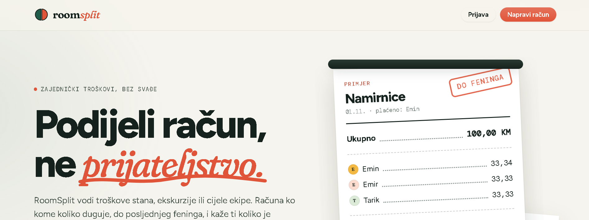
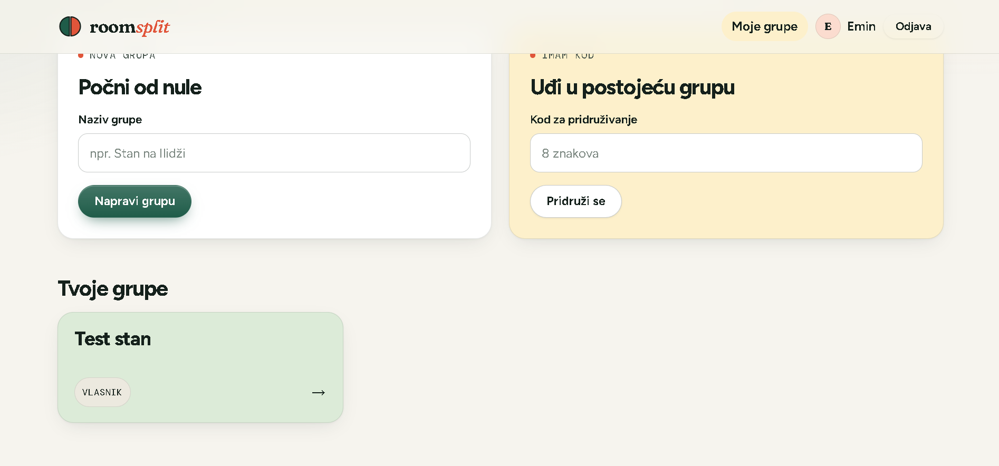
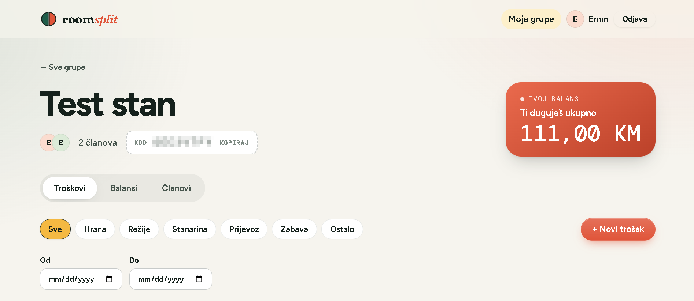
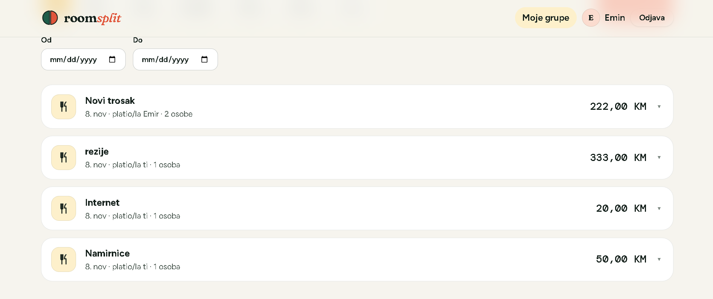
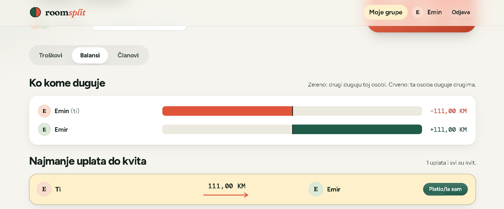
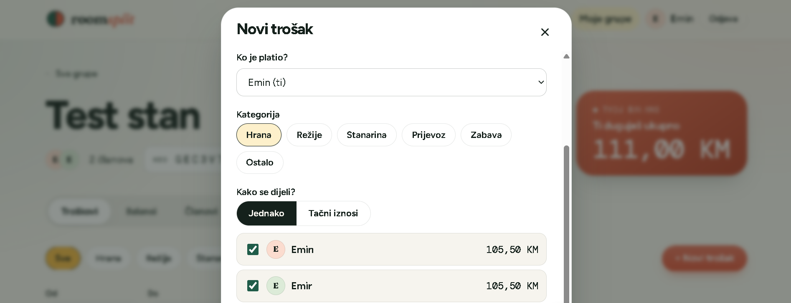
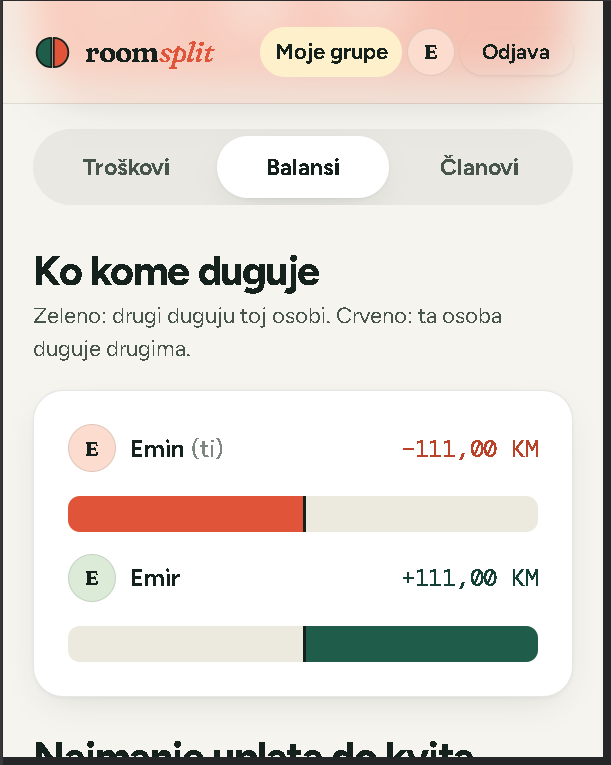

# RoomSplit

Aplikacija za dijeljenje zajedničkih troškova među cimerima i prijateljima.
Vodi troškove u grupi, računa ko kome koliko duguje i predlaže najmanji broj
uplata za poravnanje.

> **Status:** faze 1 do 6 gotove, aplikacija je live. **Live demo:** https://roomsplit-seven.vercel.app
>
> Radi na besplatnim planovima, pa se backend i baza uspavaju kad niko nije aktivan. Prvi zahtjev poslije pauze može trajati i do minutu.

## Problem

Cimeri i studenti dijele troškove (hrana, struja, putovanja) i stalno se zbune ko kome
koliko duguje. RoomSplit vodi sve troškove na jednom mjestu, tačno računa balanse
(bez grešaka u feninzima) i predlaže minimalan broj uplata kojim se svi poravnaju.

## Mogućnosti

| Mogućnost | Status |
|---|---|
| Docker Compose za lokalni PostgreSQL | ✅ gotovo |
| Verzionisane migracije baze (Flyway), tabela `users` | ✅ gotovo |
| Health endpoint `GET /api/health` s integracionim testom | ✅ gotovo |
| Registracija (`POST /api/auth/register`, BCrypt, validacija, 409 za zauzet email) | ✅ gotovo |
| Prijava (`POST /api/auth/login`), JWT (HS256, istek 60 min), zaštićen `GET /api/users/me`, CORS | ✅ gotovo |
| Grupe, članstvo i pridruživanje kodom | ✅ gotovo |
| Troškovi (jednaka podjela i tačni iznosi), paginacija, filtriranje | ✅ gotovo |
| Balansi, prijedlog poravnanja (minimalan broj uplata) i bilježenje uplata | ✅ gotovo |
| React UI: početna, prijava, grupe, troškovi, balansi, uplate | ✅ gotovo |
| Priprema za deploy: Dockerfile (multi-stage), konfiguracija iz varijabli okruženja, javni health check, `VITE_API_URL` | ✅ gotovo |
| Deploy: Neon (baza), Render (backend u Dockeru), Vercel (frontend) | ✅ gotovo, provjereno na live sajtu |

## Tehnologije

- **Backend:** Java 21, Spring Boot 4.1, Spring Security (JWT), Spring Data JPA,
  Bean Validation, Lombok, PostgreSQL 17, Flyway, JUnit 5, MockMvc
- **Frontend:** React 19, Vite, React Router, običan CSS (bez UI biblioteke), fontovi Fraunces, Figtree i DM Mono (lokalno, preko `@fontsource`)
- **Infrastruktura:** Docker Compose (lokalna baza), Dockerfile za backend; Neon (PostgreSQL), Render (backend), Vercel (frontend)

## Arhitektura

Troslojna arhitektura: `Controller → Service → Repository`. Kontroleri nemaju
poslovnu logiku, a API nikad ne vraća JPA entitete nego DTO-ove (Java `record`).
Šemu baze mijenja isključivo Flyway, a Hibernate je podešen samo da je provjerava
(`ddl-auto=validate`).

Detalji: [docs/ARHITEKTURA.md](docs/ARHITEKTURA.md) (slojevi, tok zahtjeva, model podataka)
i [docs/ODLUKE.md](docs/ODLUKE.md) (ključne tehničke odluke s obrazloženjem).

## Pokretanje lokalno

Potrebno: Java 21, Docker Desktop, Node.js.

1. **Podesi varijable okruženja.** Kopiraj `.env.example` u `.env` i upiši svoje vrijednosti
   (`.env` je u `.gitignore` i nikad ne ide na GitHub):
   ```powershell
   Copy-Item .env.example .env
   ```
   U `.env` zamijeni i `JWT_SECRET` svojim dugim nasumičnim nizom (najmanje 32 znaka; primjer
   kako ga generisati je u `.env.example`). Aplikacija ne starta ako je ključ prekratak.
2. **Pokreni bazu:**
   ```powershell
   docker compose up -d
   ```
3. **Učitaj varijable u terminal i pokreni backend** (Spring Boot ne čita `.env` sam):
   ```powershell
   Get-Content .env | ForEach-Object { $k,$v = $_ -split '=',2; Set-Item "env:$k" $v }
   cd backend
   .\mvnw.cmd spring-boot:run
   ```
   Pri startu Flyway sam primijeni migracije iz `backend/src/main/resources/db/migration`.
4. **Testovi:**
   ```powershell
   cd backend
   .\mvnw.cmd test
   ```
5. **Frontend** (u drugom terminalu, backend mora raditi na portu 8080):
   ```powershell
   cd frontend
   npm install
   npm run dev
   ```
   Otvori http://localhost:5173. Vite proxy šalje sve pozive na `/api` backendu, pa CORS ne smeta.

Na Linuxu/macOS-u koristi `./mvnw` umjesto `.\mvnw.cmd`.

## Varijable okruženja

Nijedna vrijednost ne piše u kodu. Backend ih čita pri startu:

| Varijabla | Gdje | Opis |
|---|---|---|
| `JWT_SECRET` | backend | Ključ za potpis tokena, najmanje 32 znaka. Obavezna. |
| `DB_URL`, `DB_USER`, `DB_PASSWORD` | backend | Veza na bazu u produkciji (npr. `jdbc:postgresql://host/db`). Lokalno ih nema pa se koristi `POSTGRES_*` iz `.env`. |
| `CORS_ALLOWED_ORIGINS` | backend | Adresa frontenda koja smije zvati API (više njih odvojeno zarezom). Podrazumijevano `http://localhost:5173`. |
| `PORT` | backend (kontejner) | Port na kojem server sluša; hosting ga sam postavi. Podrazumijevano 8080. |
| `VITE_API_URL` | frontend (build) | Adresa backenda u produkciji. Lokalno prazno, jer Vite proxy šalje `/api` na port 8080. |

## Backend u Dockeru

`backend/Dockerfile` je multi-stage: prva faza (JDK + Maven) kompajlira, druga (samo JRE) pokreće aplikaciju kao
običan korisnik, ne kao root. Provjereno lokalno: slika se izgradi, a kontejner s bazom odgovara na health check,
registraciju, prijavu i CORS.

```powershell
cd backend
docker build -t roomsplit-api .
docker run -p 8080:8080 -e DB_URL=... -e DB_USER=... -e DB_PASSWORD=... -e JWT_SECRET=... roomsplit-api
```

## Deploy

| Dio | Gdje | Napomena |
|---|---|---|
| Frontend | Vercel | Root `frontend`, preset Vite. `VITE_API_URL` pokazuje na backend. |
| Backend | Render (Docker, Frankfurt) | Root `backend`, `Dockerfile`. Health check na `/api/health`. |
| Baza | Neon (PostgreSQL 17, Frankfurt) | Tabele pravi Flyway pri prvom startu. |

Tajne (`DB_PASSWORD`, `JWT_SECRET`) postoje samo u postavkama hostinga, nikad u repou. Produkcija ima svoj `JWT_SECRET`,
različit od lokalnog. Backend dozvoljava samo adresu frontenda (`CORS_ALLOWED_ORIGINS`). Dijagram rasporeda je u
[docs/ARHITEKTURA.md](docs/ARHITEKTURA.md), a razlozi u [docs/ODLUKE.md](docs/ODLUKE.md).

## Struktura projekta

```
backend/    Spring Boot API (Maven)
frontend/   React aplikacija (Vite), vercel.json za deploy
docs/       Arhitektura i tehničke odluke
docker-compose.yml   Lokalni PostgreSQL
.env.example         Primjer varijabli okruženja (bez stvarnih tajni)
LEARNING_LOG.md      Dnevnik učenja tokom izrade
PROJECT_PLAN.md      Plan projekta po fazama
```

## Screenshotovi

Slike su iz live aplikacije s probnim podacima. Kod za pridruživanje grupi je zamućen.



| | |
|---|---|
|  |  |
| **Moje grupe:** nova grupa ili pridruživanje kodom | **Detalji grupe:** tvoj balans, kod i tabovi |
|  |  |
| **Troškovi:** lista s filtriranjem po kategoriji i datumu | **Balansi:** ko kome duguje i najmanji broj uplata |
|  |  |
| **Novi trošak:** podjela se vidi uživo, u feninzima | **Mobilni prikaz:** isti ekran na malom ekranu |

## Dnevnik učenja

Tok izrade i naučeno po sesijama: [LEARNING_LOG.md](LEARNING_LOG.md).
