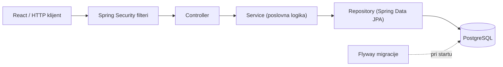
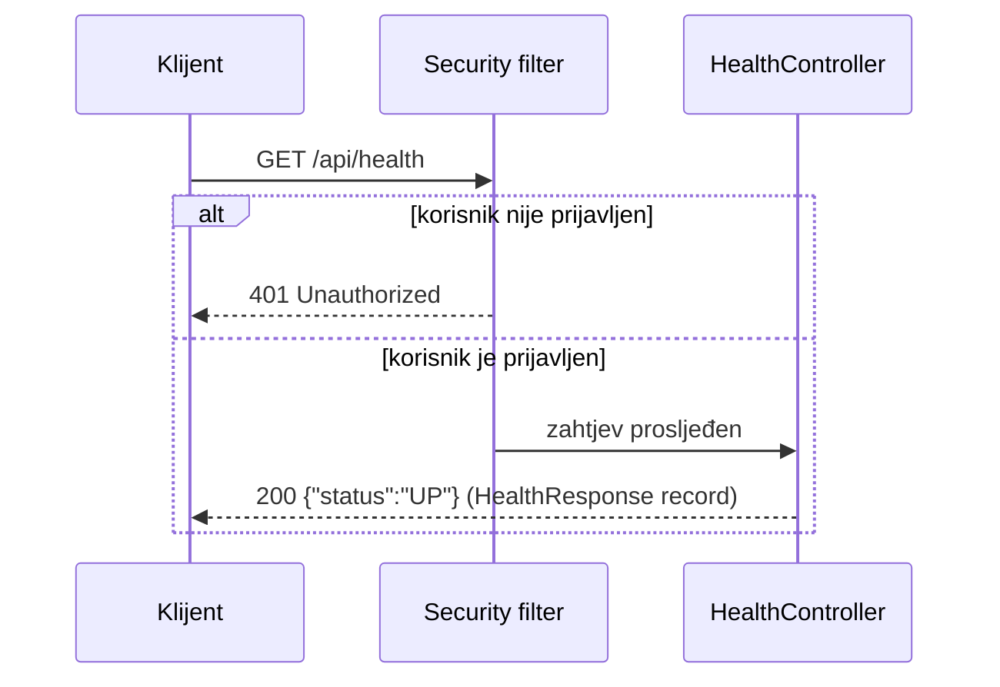
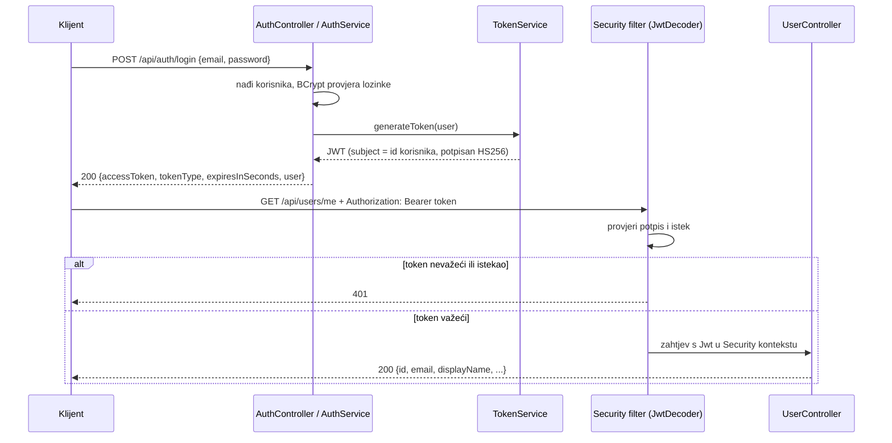
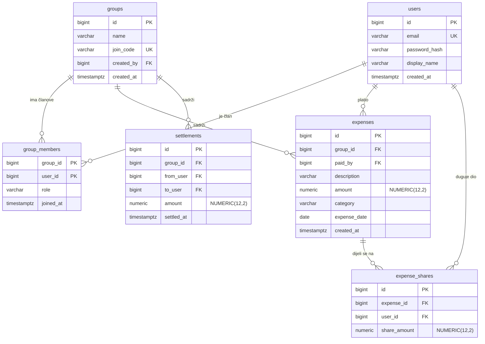

# Arhitektura RoomSplita

Dokument opisuje kako je backend organizovan i kako zahtjev prolazi kroz sistem.
Dijelovi označeni kao _planirano_ još nisu implementirani.

## Slojevi



| Sloj | Odgovornost |
|---|---|
| Security filteri | Autentikacija (JWT, _planirano_) prije nego zahtjev stigne do kontrolera |
| Controller | Prima HTTP zahtjev, validira ulaz, vraća DTO i ispravan HTTP status. Nema poslovne logike |
| Service | Poslovna pravila, autorizacija po grupi, transakcije _(planirano)_ |
| Repository | Pristup bazi preko Spring Data JPA |
| Flyway | Jedini način da se mijenja šema baze |

Paketi su organizovani po funkcionalnosti (npr. `com.emin.roomsplit.health`), a ne po tehničkom sloju.

## Tok zahtjeva (primjer: `GET /api/health`)



Napomena: 401 vraća Security filter prije kontrolera, pa 401 samo po sebi ne dokazuje da je
kontroler ispravno povezan. Zato endpoint pokriva test (`HealthControllerTest`) s oba slučaja.

## Autentikacija (JWT)



- Token potpisujemo i provjeravamo istim tajnim ključem (`JWT_SECRET`, najmanje 32 znaka) preko
  Spring Securityjevog `oauth2ResourceServer`-a (Nimbus), pa ne pišemo vlastiti filter.
- U tokenu je samo `subject` (id korisnika) i vremena izdavanja/isteka; lozinka ni hash nikad.
- Serveru ne treba sesija: svaki zahtjev nosi token (`STATELESS`).
- CORS dozvoljava origin iz `CORS_ALLOWED_ORIGINS` (podrazumijevano `http://localhost:5173`, Vite).

## Rukovanje greškama

Sve greške prolaze kroz `GlobalExceptionHandler` (`@RestControllerAdvice`) i vraćaju isti oblik
`ApiError` (`timestamp`, `status`, `message`, opciono `fieldErrors`). Kontroleri ne hvataju izuzetke sami.

| Situacija | Status |
|---|---|
| Neispravan ulaz (`@Valid`) | 400 + `fieldErrors` po polju |
| Email već postoji | 409 |
| Pogrešan email ili lozinka pri prijavi | 401 (ista poruka za oba slučaja) |
| Nema tokena ili je nevažeći/istekao | 401 (`SecurityConfig`) |
| Token važi, ali korisnik više ne postoji | 404 |
| Grupa ne postoji ili korisnik nije član | 404 (ista poruka za oba slučaja) |
| Već si član grupe | 409 |
| Nevaljana podjela (zbir, učesnik van grupe, više od 2 decimale) | 400 |
| Član grupe mijenja ili briše tuđi trošak | 403 |
| Trošak ne postoji | 404 |

## Model podataka

Implementirane su tabele `users` (V1), `groups` i `group_members` (V2). Ostale tabele su
_planirane_ i dolaze u fazi 4 (Troškovi i balansi).



**Invarijanta:** za svaki trošak vrijedi `SUM(share_amount) = amount` (podjela mora zbrojiti
tačno na originalni iznos, bez gubitka feninga).

## API (skica)

| Metoda | Putanja | Opis | Status |
|---|---|---|---|
| GET | `/api/health` | provjera da servis radi | ✅ |
| POST | `/api/auth/register` | registracija (201, 400 validacija, 409 zauzet email) | ✅ |
| POST | `/api/auth/login` | prijava, vraća JWT (401 za pogrešan email ili lozinku) | ✅ |
| GET | `/api/users/me` | prijavljeni korisnik (traži `Authorization: Bearer`) | ✅ |
| POST | `/api/groups` | nova grupa (201, vlasnik postaje OWNER) | ✅ |
| POST | `/api/groups/join` | pridruži se kodom (200, 404 pogrešan kod, 409 već član) | ✅ |
| GET | `/api/groups` | moje grupe | ✅ |
| GET | `/api/groups/{id}` | detalji (samo članovi, ostali dobijaju 404) | ✅ |
| POST | `/api/groups/{id}/expenses` | novi trošak (201; 400 nevaljana podjela; 404 nisi član) | ✅ |
| GET | `/api/groups/{id}/expenses?page=&size=&from=&to=&category=` | lista, paginirano i filtrirano | ✅ |
| GET | `/api/groups/{id}/expenses/{eid}` | jedan trošak | ✅ |
| PUT/DELETE | `/api/groups/{id}/expenses/{eid}` | izmjena (200) / brisanje (204), samo autor, ostali članovi 403 | ✅ |
| GET | `/api/groups/{id}/balances` | balans svakog člana (404 nisi član) | ✅ |
| GET | `/api/groups/{id}/settle-suggestions` | predložene uplate, najmanji mogući broj | ✅ |
| POST | `/api/groups/{id}/settlements` | zabilježi uplatu (201; 400 sam sebi ili nečlanu; 404 nisi član) | ✅ |

Svaki endpoint grupe provjerava da je prijavljeni korisnik član te grupe.

## Troškovi: primjer zahtjeva

`POST /api/groups/{id}/expenses` (isti oblik za `PUT`). Iznosi su u KM, najviše 2 decimale.

```json
{
  "description": "Namirnice",
  "amount": 100.00,
  "paidBy": 1,
  "category": "FOOD",
  "expenseDate": "2026-11-01",
  "splitType": "EQUAL",
  "participants": [{ "userId": 1 }, { "userId": 2 }, { "userId": 3 }]
}
```

- `splitType: EQUAL` dijeli jednako (100.00 na troje = 33.34 + 33.33 + 33.33).
- `splitType: EXACT` traži `amount` za svakog učesnika (`{ "userId": 1, "amount": 60.00 }`), a zbir mora biti tačno jednak ukupnom iznosu.
- `category` je neobavezna (podrazumijevano `OTHER`): `FOOD`, `UTILITIES`, `RENT`, `TRANSPORT`, `ENTERTAINMENT`, `OTHER`.
- Platilac (`paidBy`) i svi učesnici moraju biti članovi grupe. Autor unosa je korisnik iz tokena.
- Lista vraća `{ items, page, size, totalItems, totalPages }`, sortirano po datumu (najnoviji prvi); `size` je najviše 100.

## Balansi i poravnanje

`GET /balances` i `GET /settle-suggestions` ne učitavaju troškove u memoriju. `BalanceService` šalje
četiri zbirna upita (`SUM ... GROUP BY user`): koliko je ko platio, koliko mu je dodijeljeno, koliko je
isplatio i koliko primio kroz uplate. `BalanceCalculator` iz toga računa:

```
balans = platio - njegov dio + isplatio - primio
```

Pozitivan balans znači da drugi duguju njemu, negativan da on duguje. Zbir balansa u grupi je uvijek 0.

Prijedlog uplata radi `SettlementPlanner` nad balansima u feninzima:

1. Članovi s balansom 0 se izbace.
2. Ako ih je najviše 20, traži se **najveći broj podskupova čiji je zbir 0** (DP nad bitmaskama). Svaki takav
   podskup se može poravnati unutar sebe s (veličina - 1) uplata, pa je ukupan broj uplata
   `n - broj podskupova`, što je najmanje moguće.
3. Ako ih je više od 20, koristi se greedy (najveći dužnik plaća najvećem povjeriocu). Radi, ali ne mora
   dati najmanji broj uplata.

Uplata (`POST /settlements`) uvijek ide od prijavljenog korisnika. Ne može se zabilježiti uplata u tuđe ime.

## Frontend

React 19 + Vite, bez UI biblioteke. Kod je po odgovornostima:

```
frontend/src/
  api/         client.js (fetch + token + ApiError), endpoints.js (po jedna funkcija za endpoint)
  auth/        AuthProvider (ko je prijavljen), useAuth, RequireAuth (zaštićene rute)
  hooks/       useAsync (loading / error / reload)
  lib/         money.js (feninzi, podjela), dates.js, categories.js
  components/  Button, Field, Modal, Avatar, Feedback (loader, greška, prazno stanje), Layout...
  pages/       Landing, AuthPages, GroupsPage, GroupPage i group/ (tabovi troškovi, balansi, članovi)
```

Tok jednog poziva: komponenta → funkcija iz `endpoints.js` → `api()` u `client.js` (dodaje
`Authorization: Bearer`, parsira JSON) → backend. Greška se pretvara u `ApiError` s `status` i `fieldErrors`,
pa forme mogu pokazati poruku ispod tačno onog polja koje je backend odbio. Odgovor `401` odjavljuje korisnika.

Rute: `/` (početna), `/prijava`, `/registracija`, a iza prijave `/grupe` i `/grupe/:id`
(tab u adresi: `?tab=balansi` ili `?tab=clanovi`).

U razvoju Vite proxy (`vite.config.js`) prosljeđuje `/api` na `localhost:8080` (cilj se može promijeniti varijablom `API_TARGET`).
