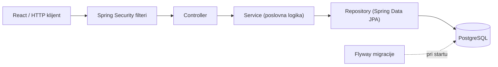
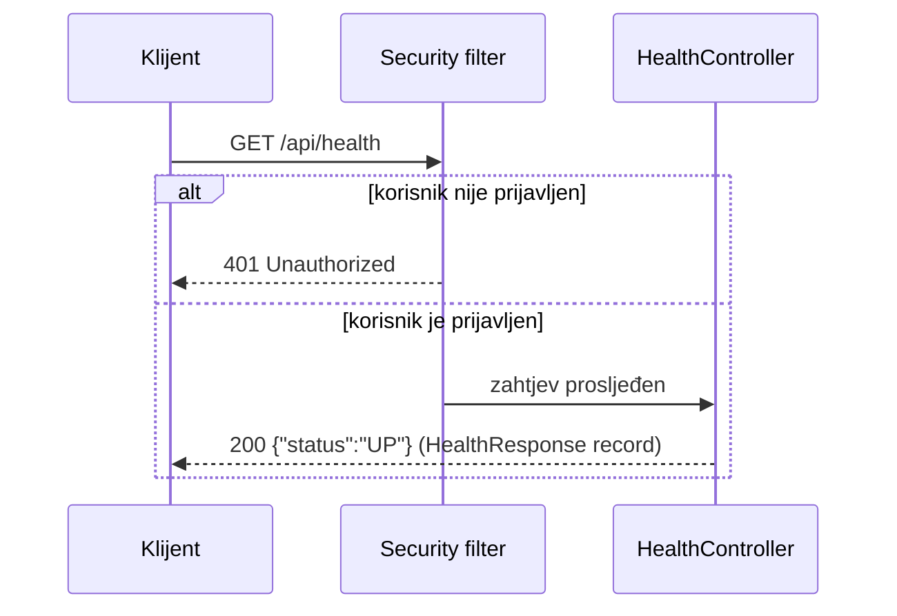
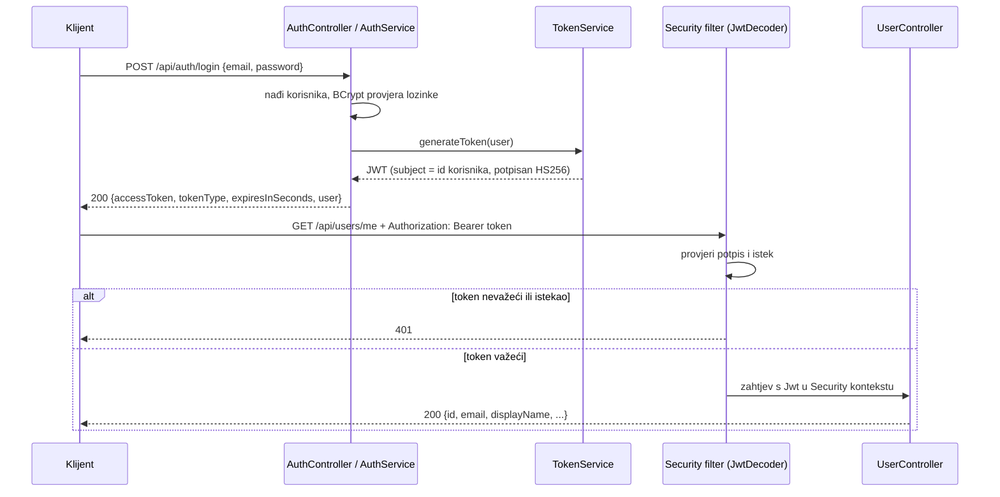
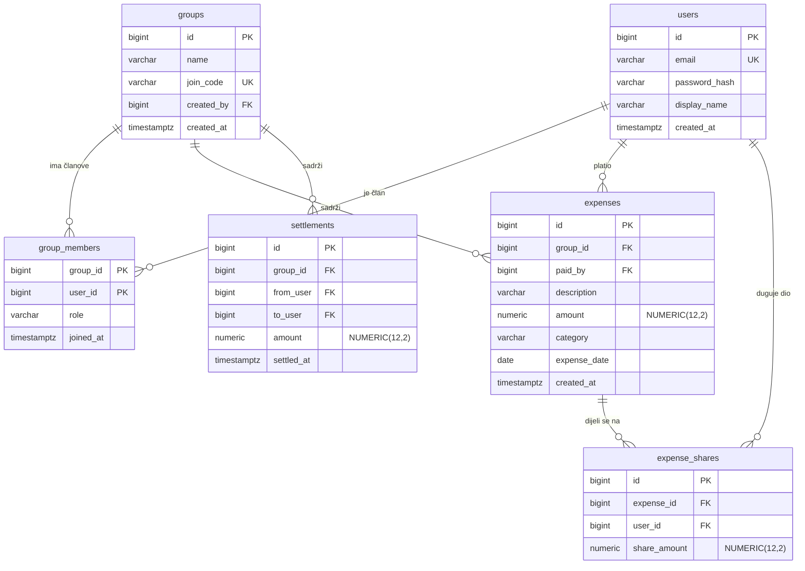

# Arhitektura RoomSplita

Dokument opisuje kako je backend organizovan i kako zahtjev prolazi kroz sistem.
Dijelovi označeni kao _planirano_ još nisu implementirani.

## Slojevi

| Sloj | Odgovornost |
|---|---|
| Security filteri | Autentikacija (JWT, _planirano_) prije nego zahtjev stigne do kontrolera |
| Controller | Prima HTTP zahtjev, validira ulaz, vraća DTO i ispravan HTTP status. Nema poslovne logike |
| Service | Poslovna pravila, autorizacija po grupi, transakcije _(planirano)_ |
| Repository | Pristup bazi preko Spring Data JPA |
| Flyway | Jedini način da se mijenja šema baze |

Paketi su organizovani po funkcionalnosti (npr. `com.emin.roomsplit.health`), a ne po tehničkom sloju.

## Tok zahtjeva (primjer: `GET /api/health`)

Napomena: 401 vraća Security filter prije kontrolera, pa 401 samo po sebi ne dokazuje da je
kontroler ispravno povezan. Zato endpoint pokriva test (`HealthControllerTest`) s oba slučaja.

## Autentikacija (JWT)

- Token potpisujemo i provjeravamo istim tajnim ključem (`JWT_SECRET`, najmanje 32 znaka) preko
  Spring Securityjevog `oauth2ResourceServer`-a (Nimbus), pa ne pišemo vlastiti filter.
- U tokenu je samo `subject` (id korisnika) i vremena izdavanja/isteka; lozinka ni hash nikad.
- Serveru ne treba sesija: svaki zahtjev nosi token (`STATELESS`).
- CORS dozvoljava origin iz `CORS_ALLOWED_ORIGINS` (podrazumijevano `http://localhost:5173`, Vite).

## Rukovanje greškama

Sve greške prolaze kroz `GlobalExceptionHandler` (`@RestControllerAdvice`) i vraćaju isti oblik
`ApiError` (`timestamp`, `status`, `message`, opciono `fieldErrors`). Kontroleri ne hvataju izuzetke sami.

| Situacija | Status |
|---|---|
| Neispravan ulaz (`@Valid`) | 400 + `fieldErrors` po polju |
| Email već postoji | 409 |
| Pogrešan email ili lozinka pri prijavi | 401 (ista poruka za oba slučaja) |
| Nema tokena ili je nevažeći/istekao | 401 (`SecurityConfig`) |
| Token važi, ali korisnik više ne postoji | 404 |

## Model podataka

Implementirana je tabela `users` (migracija `V1__create_users.sql`). Ostale tabele su
_planirane_ i dolaze u fazama 3 (Grupe) i 4 (Troškovi i balansi).

**Invarijanta:** za svaki trošak vrijedi `SUM(share_amount) = amount` (podjela mora zbrojiti
tačno na originalni iznos, bez gubitka centa).

## API (skica)

| Metoda | Putanja | Opis | Status |
|---|---|---|---|
| GET | `/api/health` | provjera da servis radi | ✅ |
| POST | `/api/auth/register` | registracija (201, 400 validacija, 409 zauzet email) | ✅ |
| POST | `/api/auth/login` | prijava, vraća JWT (401 za pogrešan email ili lozinku) | ✅ |
| GET | `/api/users/me` | prijavljeni korisnik (traži `Authorization: Bearer`) | ✅ |
| POST | `/api/groups` | nova grupa | ⏳ |
| POST | `/api/groups/join` | pridruži se kodom | ⏳ |
| GET | `/api/groups` | moje grupe | ⏳ |
| GET | `/api/groups/{id}` | detalji (samo članovi) | ⏳ |
| POST | `/api/groups/{id}/expenses` | novi trošak | ⏳ |
| GET | `/api/groups/{id}/expenses?page=&size=` | lista, paginirano | ⏳ |
| PUT/DELETE | `/api/groups/{id}/expenses/{eid}` | izmjena/brisanje | ⏳ |
| GET | `/api/groups/{id}/balances` | balansi | ⏳ |
| GET | `/api/groups/{id}/settle-suggestions` | predložena poravnanja | ⏳ |
| POST | `/api/groups/{id}/settlements` | zabilježi uplatu | ⏳ |

Svaki endpoint grupe provjerava da je prijavljeni korisnik član te grupe.
